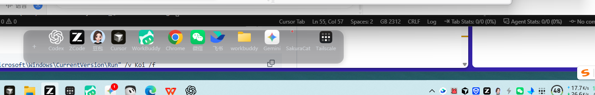
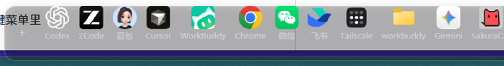
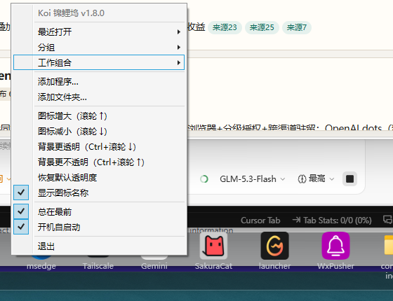
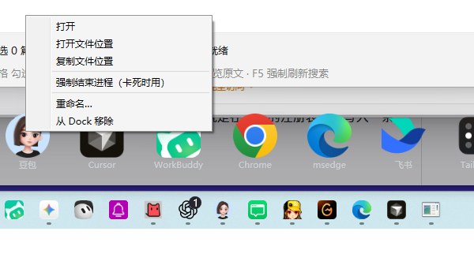

# Koi 锦鲤坞

**带文字名称的 Windows 悬浮启动栏。把常用应用、文件夹和文档放在一起，点击即可打开。**

Windows 10/11 · 单个 EXE · 无需安装 · 使用系统自带 .NET Framework

[下载 Koi.exe](https://github.com/sf00000/koi/releases/latest/download/Koi.exe) · [更新记录](CHANGELOG.md) · [详细用法](docs/usage.md)



- **看得清**：图标下方显示名称，鼠标划过时放大。
- **放得顺手**：拖入即可添加，拖动图标排序，拖动空白处移动整条启动栏。
- **方便找文件**：悬停文件夹预览内容，文档可合成文件堆。
- **按场景使用**：分组切换入口，工作组合一次打开多个应用、目录或网址。

> 截图来自已发布版本。正式版与 `master` 源码可能不同；最新代码的使用方式见下方「从源码构建」。

## 下载与开始使用

1. [下载 Koi.exe](https://github.com/sf00000/koi/releases/latest/download/Koi.exe)，放到固定目录后双击运行。
2. 将程序、快捷方式、文件夹或文档拖到启动栏；也可以点击左上角 **「＋」** 添加或粘贴路径。
3. 按需调整图标顺序和位置。需要开机启动时，右键空白处勾选 **「开机自启动」**。

图标、位置和大小会自动保存。切换版本前先退出正在运行的 Koi。



## 常用操作

| 想做什么 | 操作 |
| --- | --- |
| 打开应用、文件或文件夹 | 点击对应图标 |
| 预览文件夹 | 悬停文件夹图标，查看子目录和最近修改的文件 |
| 调整顺序 / 移动启动栏 | 拖动图标 / 拖动空白处 |
| 调整图标大小 | 在启动栏上滚动鼠标滚轮 |
| 调整背景透明度 | `Ctrl + 滚轮` |
| 图标太多时横向滚动 | `Shift + 滚轮` |
| 合并 / 拆开文件堆 | 把文档拖到另一文档上；右键文件堆可拆开，悬停清单中的文件也可拖出 |
| 按场景分组 | 右键图标 →「移动到分组」；右键空白处 →「分组」切换 |
| 一次打开多个项目 | 右键空白处 →「工作组合」→「新建工作组合…」，每行填写一个路径或网址 |

**右键空白处：全局设置。** 查看最近打开的 8 个项目、切换分组、使用工作组合，以及调整外观、置顶和开机自启动。



**右键图标：管理单个入口。** 打开或复制文件位置、重命名、移到分组、从启动栏移除；应用卡死时可使用「强制结束进程」。



## 从源码构建

在 Windows 10/11 上下载或克隆本仓库，双击 `build.bat`，然后运行生成的 **`artifacts/Koi.exe`**。

也可以在仓库目录的 PowerShell 中执行：

```powershell
.\build.bat --no-pause
.\artifacts\Koi.exe
```

使用 Windows PowerShell 5.1 和系统 .NET Framework 编译器，无需 Visual Studio、额外 .NET SDK 或 NuGet 包。仓库根目录的 `Koi.exe` 是上次正式发布的版本，构建不会覆盖它。

测试、桌面验收与发布说明见 [开发文档](docs/testing.md)。

## 其他说明

- **系统支持**：仅 Windows 10/11；目前为横向布局，没有自动隐藏或隐藏热键。
- **配置位置**：`%APPDATA%\Koi\config.xml`；诊断日志为同目录的 `errors.log`。
- **Store 应用、自定义图标与常见问题**：见 [详细用法](docs/usage.md)。
- **卸载**：取消「开机自启动」并退出，删除 `Koi.exe`；如需清除配置，再删除 `%APPDATA%\Koi\`。

[MIT License](LICENSE)
